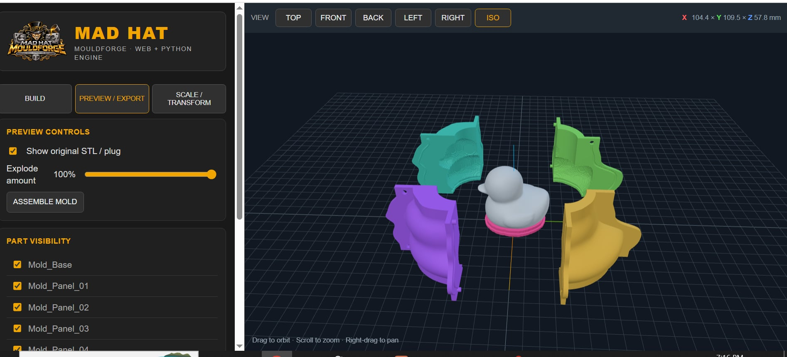
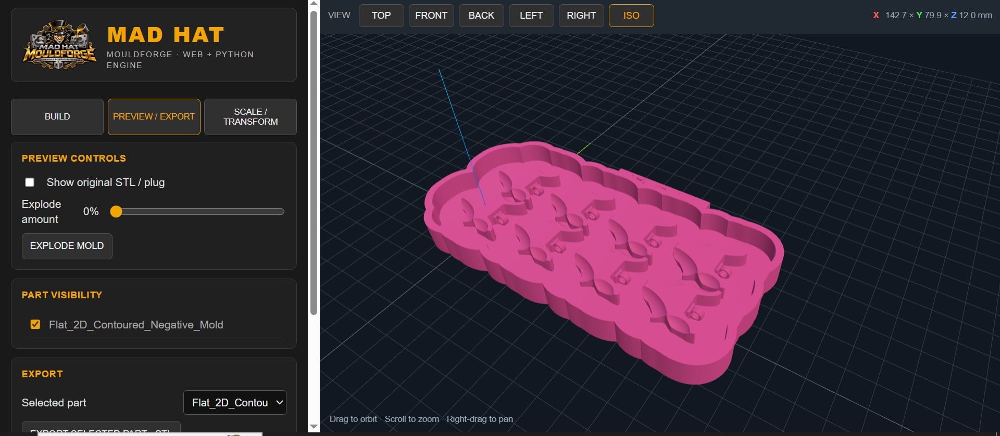
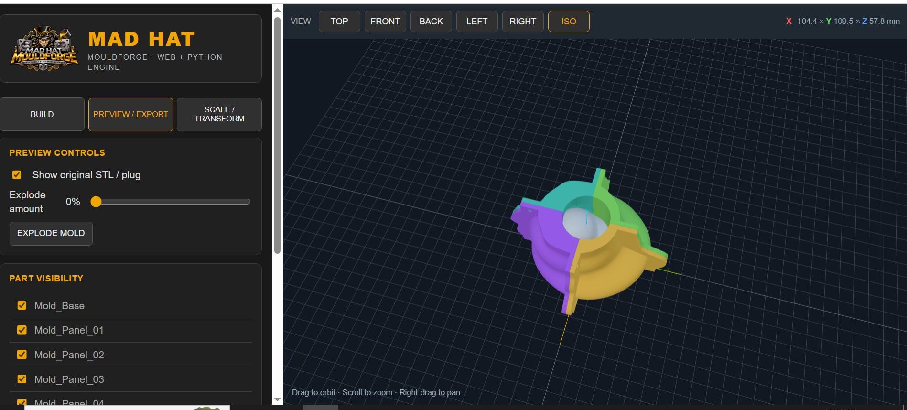
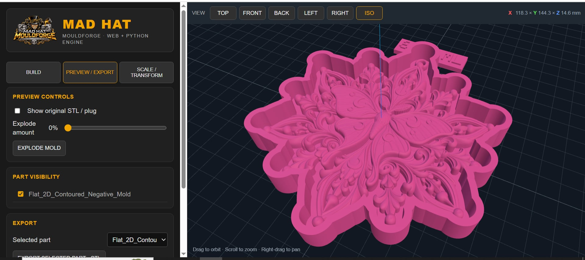

MAD HAT — NEGATIVE MOLD GENERATOR (WEB INTERFACE + PYTHON GEOMETRY ENGINE)
============================================================================

This package runs the original Python mould-generation geometry in a local
Flask backend and presents the controls and 3D preview in your web browser.
The geometry functions in engine.py are extracted from the supplied Python
source. The PySide6/PyVista desktop UI is replaced by the browser interface;
the core trimesh / Manifold3D / SciPy / Shapely mould operations are retained.

REQUIREMENTS
------------
- Windows 10/11
- Python 3.11 or 3.12 recommended (64-bit)
- Internet connection on first run for pip packages and the Three.js browser
  modules loaded from jsDelivr CDN
- STL files must be Z-up and watertight, matching the supplied source script

START
-----
1. Extract the entire ZIP to a normal folder.
2. Double-click START_MAD_HAT.bat.
3. Wait for dependency installation and the browser to open.
4. If the browser does not open automatically, visit:
      http://127.0.0.1:5000
5. Keep the black command window open while using the app.
6. Close the command window or press Ctrl+C to stop the local server.

FEATURES IN THIS WEB PORT
-------------------------
- Multiple STL import, show/hide, delete, show all and duplicate
- Live scale, rotate and move controls using the original axis mapping
- Multi-piece 3D mould and contour-following 2D flat mould generation
- Original Python offset, Boolean, flange, locating pin/socket and pour-channel
  geometry routines through trimesh + Manifold3D
- Source STL and silicone capacity estimates
- Three.js 3D preview, camera views and exploded preview
- Individual part visibility
- STL export, ZIP export and exploded ZIP export
- Save/open project ZIP for imported models

IMPORTANT
---------
This is a local web application, not a single self-contained HTML file.
The browser interface talks to the Python process at 127.0.0.1. The Python
geometry engine is required because the mould generation relies on robust
mesh voxelisation and Manifold3D Boolean operations that are not implemented
by browser JavaScript here.

The original source script rejects non-watertight input meshes. This port
retains that behaviour. It does not silently repair broken input meshes.

If Windows blocks the batch file, right-click it and choose Run. If a package
fails to install, run this in Command Prompt from the extracted folder:

    py -m pip install -r requirements.txt
    py app.py

Then open http://127.0.0.1:5000 manually.

Needs internet for install and first startup, after that it runs locally

Python can be found here
https://github.com/coatl-dev/python3.12-windows 

3mf to STL converter to convert non watertight models into STL which can be repaired and made watertight
https://github.com/blayno/Mad-Hat-3mf-to-STL

Files that arent watertight and need repair
https://3dbuilder.org/
